===== [0] role=assistant len=49357 =====
# 类飞书多维表格企业级技术设计文档

<text color="secondary" size="sm">项目代号：Mailang Base Engine · 版本：V1.0 · 状态：技术路线正式确定 · 日期：2026-11-26</text>

## 1. 技术路线决策

本方案正式采用以下技术组合：

<box border radius="lg" gap={3} padding={3}>
  <box gap={1}>
    <badge color="success">正式确定</badge>
    **前端：Vue 3 + TypeScript + VXE Table**
    <text color="secondary" size="xs">多维表格网格交互、字段编辑器、视图渲染、公式展示</text>
  </box>
  <divider color="subtle"/>
  <box gap={1}>
    **后端：Go + Hertz + Gorm**
    <text color="secondary" size="xs">领域服务、数据访问、权限、查询、事务、事件发布</text>
  </box>
  <divider color="subtle"/>
  <box gap={1}>
    **数据库：PostgreSQL**
    <text color="secondary" size="xs">关系数据、JSONB 记录、事务、索引、全文检索扩展能力</text>
  </box>
  <divider color="subtle"/>
  <box gap={1}>
    **实时协同：WebSocket + Event**
    <text color="secondary" size="xs">服务端事件广播、版本控制、乐观锁、冲突检测；不采用 Yjs 作为单元格数据主协同机制</text>
  </box>
  <divider color="subtle"/>
  <box gap={1}>
    **文档引擎：Tiptap 3 + ProseMirror + Yjs**
    <text color="secondary" size="xs">继续承担在线文档编辑与实时协同，与多维表格引擎解耦</text>
  </box>
  <divider color="subtle"/>
  <box gap={1}>
    **基础设施：Redis + MinIO + 消息事件机制**
    <text color="secondary" size="xs">缓存、分布式协调、附件存储、事件分发与异步任务</text>
  </box>
</box>

### 1.1 核心架构决策

| 决策项 | 正式方案 | 决策理由 |
|---|---|---|
| 网格引擎 | VXE Table | Vue 生态、编辑表格、虚拟滚动、复制粘贴能力 |
| 数据库 | PostgreSQL | JSONB、事务、索引和关系查询能力 |
| 记录存储 | JSONB + 关系表 + 查询投影 | 兼顾灵活字段与高频查询 |
| 字段体系 | Field Registry | 统一字段定义、编辑、校验、序列化与查询 |
| 视图体系 | View Engine | 同一数据模型支持不同视图 |
| 公式体系 | AST + 依赖图 + 求值器 | 安全计算、依赖追踪和增量更新 |
| 实时协同 | WebSocket + Event | 结构化数据编辑适合事件同步和版本控制 |
| 文档引擎 | Tiptap + Yjs | 延续已经确定的文档协同架构 |
| 建设范围 | Engine | 优先建设可复用多维表格核心引擎 |

**一个必须明确的边界：VXE Table 只是网格交互组件，不是多维表格引擎。** 它负责表格的展示和交互，Field、Record、View、Query、Formula、Relation、Permission 等领域能力由 Go 后端和 Vue 前端业务层共同实现。

### 1.2 产品边界

本期建设的是可复用的 Base Engine，而不是一次性开发一个表格页面。

本期交付：

- Base、Table、Field、Record 核心领域模型。
- 字段注册、字段配置、字段校验和字段值序列化。
- Grid 视图、筛选、排序、分页、分组基础能力。
- View 配置与视图状态管理。
- Formula 公式解析、计算和依赖管理的基础版本。
- Relation 关联字段基础能力。
- 权限校验、操作审计、版本控制。
- WebSocket 事件广播和乐观锁。
- 完整前后端扩展接口与测试体系。

本期不以完整复刻飞书所有产品功能为目标。自动化工作流、仪表盘、复杂甘特图、数据透视、AI Agent 等作为后续扩展模块。

---

## 2. 总体架构设计

### 2.1 系统架构

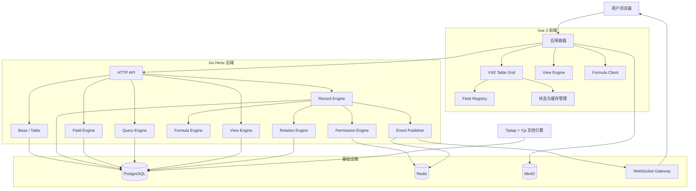

### 2.2 架构分层

| 层级 | 主要职责 | 技术实现 |
|---|---|---|
| Presentation | 页面、交互、网格、视图 | Vue 3、VXE Table |
| Application | 用例编排、事务协调 | Go Application Service |
| Domain | 业务规则、领域模型 | Go Domain Model |
| Infrastructure | 数据库、缓存、文件、消息 | Gorm、PostgreSQL、Redis、MinIO |
| Realtime | 事件订阅、广播、连接管理 | WebSocket |
| Document | 富文本与文档协同 | Tiptap、ProseMirror、Yjs |

### 2.3 关键设计原则

1. **元数据驱动**：字段类型、字段配置、视图配置都由元数据定义，不为每种字段开发一套独立业务流程。
2. **数据与视图分离**：记录数据只有一份，Grid、Kanban、Calendar 等视图读取同一份数据。
3. **字段能力插件化**：增加字段类型不应要求重写 Record Engine。
4. **查询统一化**：筛选、排序、分组和分页统一经过 Query Engine。
5. **服务端为权威**：权限、数据校验、公式计算和版本冲突均由服务端最终裁定。
6. **事件驱动同步**：数据库事务成功后再广播事件，不能先广播再尝试写库。
7. **文档与多维表格独立**：Tiptap/Yjs 不承担多维表格记录的主存储与协同。

## 3. MECE 模块拆解

整体采用领域模块化架构（Modular Monolith），初期不拆成大量微服务。各模块通过明确的接口协作，后续再根据性能、团队和部署需求拆分。

### 3.1 核心领域模块

| 模块 | 子模块 | 核心职责 | 优先级 |
|---|---|---|---|
| Base Engine | App、Workspace | 多维表格应用容器、空间归属 | P0 |
| Table Engine | Table、Schema | 数据表管理、表结构版本 | P0 |
| Field Engine | Field、Registry、Validator | 字段类型注册、配置、校验、转换 | P0 |
| Record Engine | Record、Batch、Version | 记录 CRUD、批量操作、版本管理 | P0 |
| View Engine | View、ViewConfig、Renderer | 视图配置、视图查询参数 | P0 |
| Query Engine | Filter、Sort、Group、Pagination | 统一查询和执行计划 | P0 |
| Permission Engine | Role、Policy、DataScope | 应用、表、字段、记录权限 | P0 |
| Relation Engine | Link、Lookup、Rollup | 跨表关联与聚合 | P1 |
| Formula Engine | Parser、AST、Evaluator、Dependency | 公式解析、求值、依赖更新 | P1 |
| Realtime Engine | Event、WebSocket、Subscription | 实时事件推送与订阅 | P0 |
| Audit Engine | OperationLog、Revision | 操作记录、版本追踪 | P0 |
| Attachment Engine | File、Storage | 附件上传、访问和关联 | P1 |
| Import/Export | CSV、Excel、JSON | 数据导入导出 | P1 |
| Automation Engine | Trigger、Action、Workflow | 自动化流程 | P2 |
| Dashboard Engine | Chart、Widget、Metric | 仪表盘与数据分析 | P2 |
| Open API | Token、Webhook、API | 对外集成能力 | P2 |

### 3.2 模块职责与依赖关系

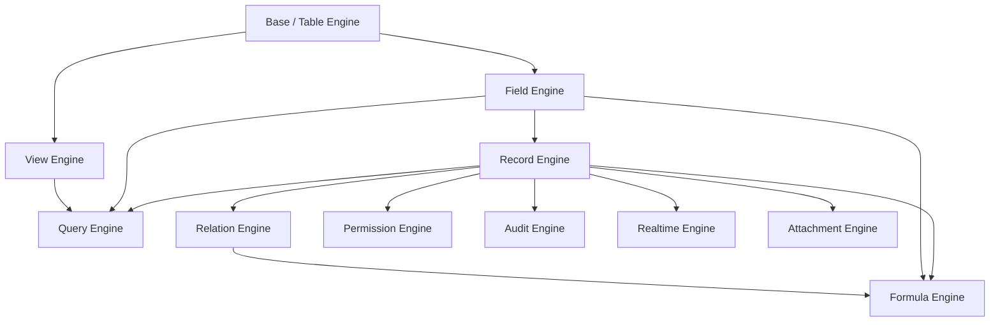

**依赖约束：**

- Field Engine 不直接依赖具体页面组件。
- Query Engine 不依赖 VXE Table。
- Formula Engine 不依赖 Vue，也不依赖具体数据库 ORM。
- Record Engine 不允许绕过 Permission Engine 修改数据。
- Realtime Engine 只传播已提交的业务事件，不承担数据持久化。
- View Engine 保存视图配置，不复制记录数据。
- Attachment Engine 负责文件元数据与存储，不将文件二进制直接塞入 JSONB 记录。

### 3.3 本期 Engine 范围

<badge color="success">本期必须交付</badge>

- Base、Table、Field、Record 的完整 CRUD。
- Field Registry 和第一批常用字段类型。
- Grid View、View Config。
- Query Engine 的筛选、排序、分页。
- JSONB 记录存储及高频查询投影。
- 乐观锁、事件广播和操作审计。
- 权限基础框架。
- 公式引擎基础实现和关联字段基础实现。
- 可扩展模块接口、单元测试、集成测试、性能测试。

<badge color="warning">本期预留接口，后续迭代</badge>

- Kanban、Calendar、Gallery、Form、Gantt 等完整视图。
- 复杂 Lookup、Rollup、跨表公式。
- 自动化流程、仪表盘、Webhook。
- AI 建表、AI 公式生成、自然语言查询。
- 多区域、多活部署和超大规模分片。

---

## 4. 核心领域模型与 ER 设计

### 4.1 核心对象关系

多维表格的基础关系：

- 一个 Workspace 可以拥有多个 Base。
- 一个 Base 可以拥有多张 Table。
- 一个 Table 拥有多个 Field、Record 和 View。
- 一个 Record 对应一条数据记录。
- 一个 Field 定义该记录中某个数据项的类型与规则。
- 一个 View 定义同一张 Table 的显示和查询方式。
- 一个 Relation Field 连接两张 Table 中的 Record。
- 一个 Formula Field 通过 AST 和依赖关系计算结果。

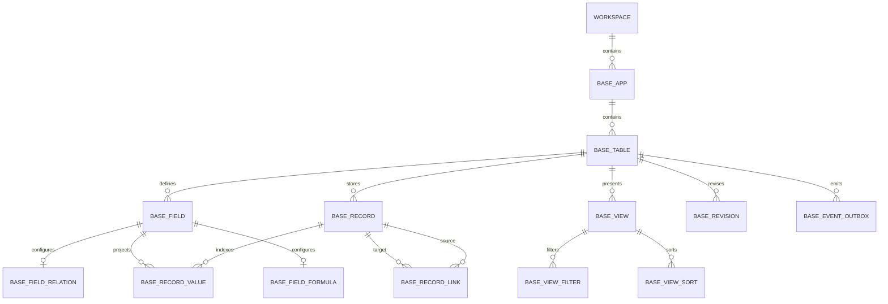

### 4.2 数据库设计原则

正式采用：

**元数据表 + JSONB 记录主表 + 关联关系表 + 高频查询投影表 + 审计事件表。**

其中：

- `base_field`：定义字段。
- `base_record.data`：记录字段值的权威存储。
- `base_record_value`：为需要高频筛选、排序、分组的字段建立类型化查询投影。
- `base_record_link`：存储记录间关系。
- `base_field_formula`：存储公式定义。
- `base_event_outbox`：事务内保存待发布事件。

不采用纯 EAV 作为主存储，也不采用每张用户自定义 Table 对应一张 PostgreSQL 物理表的方案。

### 4.3 核心表结构

以下字段为核心逻辑结构。实际迁移时，应统一补充主键、创建时间、更新时间、软删除、租户字段和必要索引。

#### 4.3.1 Workspace 与 Base

**workspace**

| 字段 | 类型 | 说明 |
|---|---|---|
| id | UUID | 主键 |
| tenant_id | UUID | 租户 |
| name | VARCHAR(128) | 空间名称 |
| owner_id | UUID | 创建者 |
| status | SMALLINT | 状态 |
| created_at | TIMESTAMPTZ | 创建时间 |

**base_app**

| 字段 | 类型 | 说明 |
|---|---|---|
| id | UUID | 主键 |
| tenant_id | UUID | 租户 |
| workspace_id | UUID | 所属空间 |
| name | VARCHAR(128) | Base 名称 |
| description | TEXT | 描述 |
| icon | VARCHAR(128) | 图标 |
| owner_id | UUID | 创建者 |
| schema_version | BIGINT | 结构版本 |
| status | SMALLINT | 状态 |

#### 4.3.2 Table

**base_table**

| 字段 | 类型 | 说明 |
|---|---|---|
| id | UUID | 主键 |
| tenant_id | UUID | 租户 |
| base_id | UUID | Base ID |
| name | VARCHAR(128) | 表名称 |
| description | TEXT | 描述 |
| primary_field_id | UUID | 主字段 |
| sort_order | INTEGER | 显示顺序 |
| schema_version | BIGINT | Schema 版本 |
| settings | JSONB | 表级配置 |
| status | SMALLINT | 状态 |

约束：

- 同一个 Base 下表名可以按产品规则要求唯一。
- `primary_field_id` 必须属于当前 Table。
- 表删除采用软删除或回收站机制。
- 修改字段结构时递增 `schema_version`。

#### 4.3.3 Field

**base_field**

| 字段 | 类型 | 说明 |
|---|---|---|
| id | UUID | 主键 |
| tenant_id | UUID | 租户 |
| table_id | UUID | 所属表 |
| name | VARCHAR(128) | 字段名称 |
| type | VARCHAR(48) | 字段类型 |
| config | JSONB | 类型配置 |
| required | BOOLEAN | 是否必填 |
| unique_flag | BOOLEAN | 是否唯一 |
| is_primary | BOOLEAN | 是否主字段 |
| is_system | BOOLEAN | 是否系统字段 |
| sort_order | INTEGER | 字段顺序 |
| version | BIGINT | 字段版本 |
| status | SMALLINT | 状态 |

字段类型与配置必须通过 Field Registry 校验，不能仅依赖前端传入的 `type`。

#### 4.3.4 Record

**base_record**

| 字段 | 类型 | 说明 |
|---|---|---|
| id | UUID | 主键 |
| tenant_id | UUID | 租户 |
| base_id | UUID | Base ID |
| table_id | UUID | Table ID |
| data | JSONB | 记录字段值 |
| version | BIGINT | 乐观锁版本 |
| created_by | UUID | 创建人 |
| updated_by | UUID | 修改人 |
| created_at | TIMESTAMPTZ | 创建时间 |
| updated_at | TIMESTAMPTZ | 更新时间 |
| deleted_at | TIMESTAMPTZ | 删除时间 |

记录数据建议使用 Field ID 作为 JSONB Key，而不是字段名称。

示例：

```json
{
  "field_uuid_001": "张三",
  "field_uuid_002": 1200.50,
  "field_uuid_003": "2026-11-26",
  "field_uuid_004": true,
  "field_uuid_005": ["option_001", "option_002"]
}
```

这样字段重命名不会导致记录数据迁移，字段删除和恢复也更容易处理。

**索引建议：**

```sql
CREATE INDEX idx_record_table
ON base_record (tenant_id, table_id, id)
WHERE deleted_at IS NULL;

CREATE INDEX idx_record_data_gin
ON base_record USING GIN (data jsonb_path_ops);

CREATE INDEX idx_record_updated
ON base_record (tenant_id, table_id, updated_at DESC)
WHERE deleted_at IS NULL;
```

GIN 索引主要用于 JSONB 包含查询，并不能自动解决任意动态字段的排序、范围筛选问题。因此需要配合查询投影表。

#### 4.3.5 高频查询投影

**base_record_value**

| 字段 | 类型 | 说明 |
|---|---|---|
| id | UUID | 主键 |
| tenant_id | UUID | 租户 |
| table_id | UUID | 表 ID |
| record_id | UUID | 记录 ID |
| field_id | UUID | 字段 ID |
| value_type | VARCHAR(24) | 值类型 |
| value_text | TEXT | 文本值 |
| value_number | NUMERIC | 数值 |
| value_date | TIMESTAMPTZ | 日期 |
| value_bool | BOOLEAN | 布尔值 |
| value_json | JSONB | 复杂值 |
| updated_at | TIMESTAMPTZ | 更新时间 |

该表不是权威数据源，而是查询优化投影。

**写入规则：**

1. 校验字段定义和数据类型。
2. 更新 `base_record.data`。
3. 在同一数据库事务中更新对应投影。
4. 更新公式依赖和关联数据的待计算状态。
5. 增加 Record 版本。
6. 写入审计和 Outbox 事件。
7. 提交事务。
8. 异步发布事件。

对于高频字段，根据实际查询需求建立复合索引，例如：

```sql
CREATE INDEX idx_record_value_number
ON base_record_value
(tenant_id, table_id, field_id, value_number, record_id);

CREATE INDEX idx_record_value_text
ON base_record_value
(tenant_id, table_id, field_id, value_text, record_id);

CREATE INDEX idx_record_value_date
ON base_record_value
(tenant_id, table_id, field_id, value_date, record_id);
```

索引是否建立应根据查询统计和字段配置决定，避免所有字段无差别建立大量索引。

#### 4.3.6 View

**base_view**

| 字段 | 类型 | 说明 |
|---|---|---|
| id | UUID | 主键 |
| tenant_id | UUID | 租户 |
| table_id | UUID | 所属表 |
| name | VARCHAR(128) | 视图名称 |
| type | VARCHAR(32) | grid、kanban 等 |
| config | JSONB | 视图配置 |
| is_default | BOOLEAN | 默认视图 |
| owner_id | UUID | 创建人 |
| version | BIGINT | 配置版本 |
| status | SMALLINT | 状态 |

视图配置示例：

```json
{
  "layout": {
    "rowHeight": 36,
    "frozenFields": ["field_uuid_001"]
  },
  "fieldVisibility": {
    "field_uuid_001": true,
    "field_uuid_002": true,
    "field_uuid_003": false
  },
  "fieldWidths": {
    "field_uuid_001": 180,
    "field_uuid_002": 120
  },
  "filters": [],
  "sorts": [],
  "groups": [],
  "pagination": {
    "pageSize": 100
  }
}
```

多人共享视图配置与个人视图偏好应分开存储。个人列宽、临时筛选等状态不应覆盖全员共享配置。

建议增加：

- `base_view_member`：个人视图偏好。
- `base_view_filter`：可选的结构化筛选配置。
- `base_view_sort`：可选的结构化排序配置。

初期可以将过滤、排序配置全部保存在 `config` JSONB 中，只有当需要独立查询、复杂权限或版本审计时，再拆为关系表。

#### 4.3.7 Relation

**base_field_relation**

| 字段 | 类型 | 说明 |
|---|---|---|
| field_id | UUID | 关联字段 ID |
| target_table_id | UUID | 目标表 |
| relation_type | VARCHAR(24) | one_to_one、one_to_many、many_to_many |
| inverse_field_id | UUID | 反向字段 |
| allow_multiple | BOOLEAN | 是否多选 |
| config | JSONB | 关系配置 |

**base_record_link**

| 字段 | 类型 | 说明 |
|---|---|---|
| id | UUID | 主键 |
| tenant_id | UUID | 租户 |
| source_table_id | UUID | 来源表 |
| source_record_id | UUID | 来源记录 |
| field_id | UUID | 关联字段 |
| target_table_id | UUID | 目标表 |
| target_record_id | UUID | 目标记录 |
| sort_order | INTEGER | 关系顺序 |

建议建立唯一约束，避免同一关系重复写入：

```sql
CREATE UNIQUE INDEX uk_record_link
ON base_record_link
(tenant_id, field_id, source_record_id, target_record_id);
```

#### 4.3.8 Formula

**base_field_formula**

| 字段 | 类型 | 说明 |
|---|---|---|
| field_id | UUID | 公式字段 |
| expression | TEXT | 原始公式 |
| ast | JSONB | 解析后的 AST |
| dependency_config | JSONB | 依赖配置 |
| calculation_mode | VARCHAR(24) | sync、async |
| formula_version | BIGINT | 公式版本 |
| status | SMALLINT | 状态 |

**base_formula_dependency**

| 字段 | 类型 | 说明 |
|---|---|---|
| id | UUID | 主键 |
| tenant_id | UUID | 租户 |
| table_id | UUID | 表 ID |
| formula_field_id | UUID | 公式字段 |
| dependency_field_id | UUID | 被依赖字段 |
| dependency_type | VARCHAR(24) | field、relation、lookup |
| dependency_table_id | UUID | 依赖表 |

#### 4.3.9 审计、事件与版本

**base_operation_log**

| 字段 | 类型 | 说明 |
|---|---|---|
| id | UUID | 主键 |
| tenant_id | UUID | 租户 |
| base_id | UUID | Base |
| table_id | UUID | Table |
| record_id | UUID | Record |
| operator_id | UUID | 操作人 |
| operation | VARCHAR(32) | 操作类型 |
| before_data | JSONB | 修改前 |
| after_data | JSONB | 修改后 |
| request_id | VARCHAR(64) | 请求追踪 ID |
| created_at | TIMESTAMPTZ | 时间 |

**base_event_outbox**

| 字段 | 类型 | 说明 |
|---|---|---|
| id | UUID | 事件 ID |
| tenant_id | UUID | 租户 |
| aggregate_type | VARCHAR(32) | 聚合类型 |
| aggregate_id | UUID | 聚合 ID |
| event_type | VARCHAR(64) | 事件类型 |
| payload | JSONB | 事件内容 |
| status | SMALLINT | 待发布、已发布、失败 |
| retry_count | INTEGER | 重试次数 |
| created_at | TIMESTAMPTZ | 创建时间 |
| published_at | TIMESTAMPTZ | 发布时间 |

Outbox 表与业务数据在同一事务提交，事件消费者通过幂等机制处理重复消息。

### 4.4 ER 设计补充

除上述核心表外，企业级实现还需要以下辅助表：

| 表 | 作用 |
|---|---|
| `base_member` | Base 成员 |
| `base_role` | Base 角色 |
| `base_permission_policy` | 权限策略 |
| `base_field_option` | 单选、多选等选项配置 |
| `base_record_revision` | 记录历史版本 |
| `base_view_member` | 个人视图配置 |
| `base_file` | 附件元数据 |
| `base_idempotency` | 幂等请求记录 |
| `base_formula_task` | 异步公式计算任务 |
| `base_event_subscription` | 事件订阅关系 |

所有核心业务表均应带 `tenant_id`，并在 Repository 层强制租户过滤。必要时使用 PostgreSQL Row Level Security 作为纵深防御，但不能将数据库 RLS 当作唯一权限控制手段。

---

## 5. Field Registry 字段注册体系

这是整个多维表格最重要的扩展机制之一。

### 5.1 设计目标

字段注册体系应解决：

- 字段类型统一注册。
- 字段配置动态定义。
- 字段值统一校验。
- 前端编辑器自动匹配。
- 前端渲染器自动匹配。
- 后端序列化与反序列化。
- 字段查询、过滤、排序能力统一管理。
- 字段类型可以独立扩展。

### 5.2 字段类型分类

| 分类 | 类型 | 示例 |
|---|---|---|
| 基础文本 | text、long_text | 姓名、备注 |
| 数值 | number、currency、percent、rating | 金额、比例 |
| 日期 | date、datetime | 创建日期、截止日期 |
| 布尔 | checkbox | 是否完成 |
| 选项 | single_select、multi_select | 状态、标签 |
| 联系信息 | email、phone、url | 邮箱、电话 |
| 人员 | user、user_group | 负责人、协作人 |
| 附件 | attachment | 图片、文件 |
| 系统字段 | created_at、updated_at、created_by、updated_by | 审计信息 |
| 关系字段 | link | 关联其他表记录 |
| 计算字段 | formula、lookup、rollup | 计算、引用、汇总 |

### 5.3 字段能力接口

后端使用统一接口描述字段能力：

```go
type FieldType string

type FieldDefinition struct {
    Type          FieldType
    Name          string
    Version       int
    ConfigSchema  any
    Capabilities  FieldCapabilities
}

type FieldCapabilities struct {
    Editable   bool
    Filterable bool
    Sortable   bool
    Groupable  bool
    Indexable  bool
    Computed   bool
}

type FieldHandler interface {
    Definition() FieldDefinition

    ValidateConfig(config map[string]any) error

    ValidateValue(
        value any,
        config map[string]any,
    ) error

    Normalize(
        value any,
        config map[string]any,
    ) (any, error)

    Serialize(value any) ([]byte, error)

    Deserialize(raw []byte) (any, error)

    BuildFilter(
        operator string,
        value any,
    ) (QueryCondition, error)

    BuildSort(direction string) (SortExpression, error)
}
```

以上是接口方向，实际实现中应将 SQL 表达式构建限制在 Query Engine 的受控表达式体系内，避免字段处理器直接拼接 SQL。

### 5.4 字段注册示例

```go
type Registry struct {
    handlers map[FieldType]FieldHandler
}

func NewRegistry() *Registry {
    return &Registry{
        handlers: make(map[FieldType]FieldHandler),
    }
}

func (r *Registry) Register(handler FieldHandler) error {
    def := handler.Definition()

    if def.Type == "" {
        return errors.New("field type is required")
    }

    if _, exists := r.handlers[def.Type]; exists {
        return fmt.Errorf("field type already registered: %s", def.Type)
    }

    r.handlers[def.Type] = handler
    return nil
}

func (r *Registry) Get(fieldType FieldType) (FieldHandler, bool) {
    handler, ok := r.handlers[fieldType]
    return handler, ok
}
```

实际项目还应增加：

- 注册冲突检查。
- 字段类型版本管理。
- 字段配置 Schema 校验。
- 插件初始化阶段校验。
- 字段类型迁移机制。
- 未知字段类型的兼容策略。

### 5.5 前端字段注册

前端采用 TypeScript Registry：

```ts
export interface FieldPlugin {
  type: string
  label: string
  version: number

  createEditor: () => Component
  createRenderer: () => Component

  validate: (
    value: unknown,
    config: Record<string, unknown>
  ) => boolean

  normalize: (value: unknown) => unknown

  capabilities: {
    editable: boolean
    filterable: boolean
    sortable: boolean
    groupable: boolean
  }
}

export class FieldRegistry {
  private plugins = new Map<string, FieldPlugin>()

  register(plugin: FieldPlugin) {
    if (this.plugins.has(plugin.type)) {
      throw new Error(`Field already registered: ${plugin.type}`)
    }

    this.plugins.set(plugin.type, plugin)
  }

  get(type: string) {
    return this.plugins.get(type)
  }
}
```

前端 Registry 只负责 UI 和用户交互；后端 Registry 才是字段类型、值合法性和查询能力的最终权威。

### 5.6 字段注册调用链

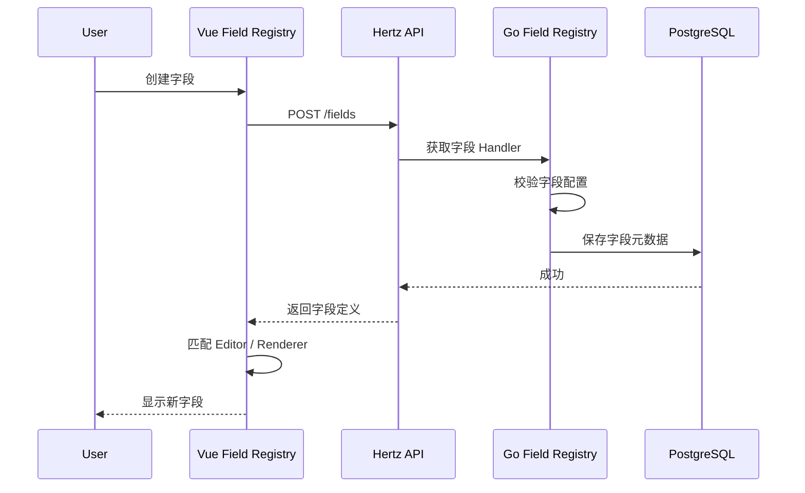

### 5.7 字段变更与迁移

字段变更必须区分两类：

- **配置变化**：例如修改数字精度、选项颜色，通常只更新字段元数据。
- **数据结构变化**：例如文本改为数字、单选改为多选，必须执行数据兼容检查与迁移。

不允许直接把 `base_field.type` 从 `text` 改为 `number`，却不处理已有记录。

推荐迁移流程：

1. 校验旧类型与新类型是否兼容。
2. 生成字段迁移计划。
3. 对现有记录执行预校验。
4. 记录无法转换的数据。
5. 执行分批迁移。
6. 更新查询投影。
7. 更新公式依赖。
8. 更新 Schema Version。
9. 记录审计信息。

---

## 6. View Engine 视图引擎

### 6.1 核心设计

视图只定义数据的组织和展示方式，不拥有独立记录数据。

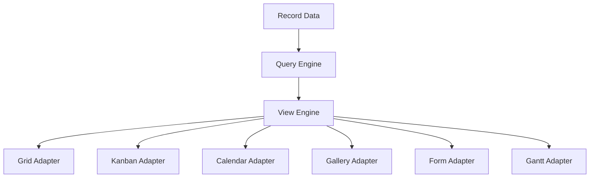

### 6.2 视图类型

| 类型 | 主要配置 | 数据组织方式 | 本期 |
|---|---|---|---|
| Grid | 列宽、冻结列、排序、筛选 | 二维表格 | P0 |
| Kanban | 分组字段、卡片字段 | 按选项分组 | 预留 |
| Calendar | 日期字段、卡片字段 | 按日期分组 | 预留 |
| Gallery | 封面字段、卡片布局 | 卡片展示 | 预留 |
| Form | 表单字段、必填规则 | 表单提交 | 预留 |
| Gantt | 开始日期、结束日期、依赖 | 时间线 | 后续 |

### 6.3 View Config 统一协议

```ts
interface ViewConfig {
  version: number
  type: 'grid' | 'kanban' | 'calendar' | 'gallery' | 'form' | 'gantt'

  fieldVisibility: Record<string, boolean>

  fieldWidths?: Record<string, number>

  frozenFields?: string[]

  filters: FilterGroup[]

  sorts: SortRule[]

  groups: GroupRule[]

  pagination: {
    pageSize: number
  }

  layout?: Record<string, unknown>
}
```

过滤表达式：

```json
{
  "logic": "AND",
  "conditions": [
    {
      "fieldId": "field_status",
      "operator": "eq",
      "value": "进行中"
    },
    {
      "fieldId": "field_amount",
      "operator": "gte",
      "value": 1000
    }
  ],
  "children": []
}
```

### 6.4 Query Engine

Query Engine 是 View Engine 的统一数据执行层。

它负责：

- 解析 Filter AST。
- 验证字段是否支持对应操作符。
- 处理权限条件。
- 生成受控 SQL 查询计划。
- 处理排序、分组和分页。
- 处理关联字段查询。
- 返回记录和字段值。
- 生成查询性能指标。

查询请求不允许直接传入 SQL、任意列名或未经校验的数据库表达式。

建议定义统一查询结构：

```go
type QueryRequest struct {
    TableID    string
    ViewID     string
    Filters    FilterGroup
    Sorts      []SortRule
    Groups     []GroupRule
    PageSize   int
    Cursor     string
}
```

### 6.5 查询执行流程

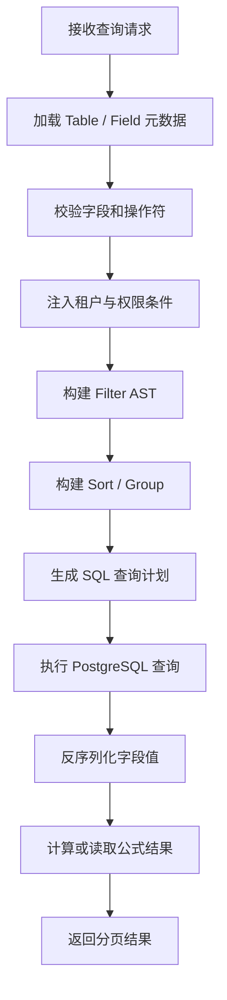

### 6.6 查询性能设计

- 默认分页，不允许无边界加载全表。
- 大数据量优先采用 Cursor Pagination。
- 高频筛选字段通过 `base_record_value` 投影查询。
- 低频复杂查询使用 JSONB 表达式并配合合适索引。
- 分组聚合尽量在数据库完成。
- 视图配置缓存于 Redis，数据查询结果缓存应谨慎，避免实时一致性问题。
- Query Engine 必须限制最大分页、最大分组层级、最大过滤条件数量和查询执行时间。

推荐 Grid 查询返回结构：

```json
{
  "tableId": "table_uuid",
  "viewId": "view_uuid",
  "schemaVersion": 12,
  "records": [
    {
      "id": "record_uuid",
      "version": 3,
      "fields": {
        "field_uuid_001": "张三",
        "field_uuid_002": 1200.5
      }
    }
  ],
  "page": {
    "nextCursor": "opaque_cursor",
    "hasMore": true
  }
}
```

VXE Table 通过该结构构建行数据；前端不应直接依赖 PostgreSQL JSONB 的内部存储结构。

---

## 7. Formula Engine 公式引擎

### 7.1 设计原则

公式引擎必须独立于 Record Engine，不能把公式计算逻辑散落在 API、前端组件或数据库触发器中。

采用：

**Lexer → Parser → AST → Dependency Graph → Evaluator → Result Cache**

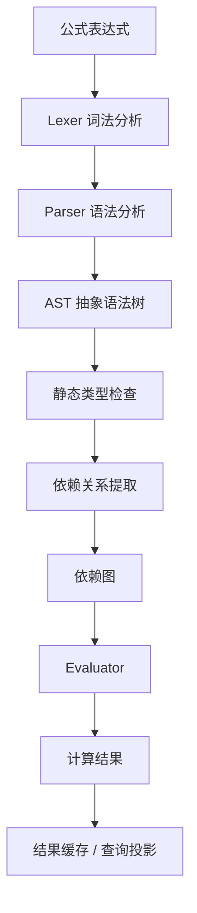

### 7.2 公式语法

第一阶段支持：

- 数值：`1`、`2.5`
- 字符串：`"hello"`
- 字段引用：`{金额}`
- 算术运算：`+`、`-`、`*`、`/`
- 比较运算：`=`、`!=`、`>`、`<`、`>=`、`<=`
- 逻辑运算：`AND`、`OR`、`NOT`
- 函数调用：`SUM()`、`IF()` 等

示例：

```text
IF({销售额} > 1000, {销售额} * 0.1, 0)
```

### 7.3 第一阶段函数

| 函数 | 功能 |
|---|---|
| SUM | 求和 |
| AVERAGE | 平均值 |
| COUNT | 计数 |
| MIN | 最小值 |
| MAX | 最大值 |
| IF | 条件判断 |
| AND | 逻辑与 |
| OR | 逻辑或 |
| NOT | 逻辑非 |
| CONCATENATE | 字符串拼接 |
| ROUND | 四舍五入 |
| ABS | 绝对值 |
| DATE | 日期构造 |
| TODAY | 当前日期 |

函数参数数量、参数类型、返回类型必须在函数注册时定义。

### 7.4 AST 设计

例如：

```text
IF({销售额} > 1000, {销售额} * 0.1, 0)
```

解析后：

```json
{
  "type": "CallExpression",
  "name": "IF",
  "arguments": [
    {
      "type": "BinaryExpression",
      "operator": ">",
      "left": {
        "type": "FieldReference",
        "fieldId": "field_sales"
      },
      "right": {
        "type": "NumberLiteral",
        "value": 1000
      }
    },
    {
      "type": "BinaryExpression",
      "operator": "*",
      "left": {
        "type": "FieldReference",
        "fieldId": "field_sales"
      },
      "right": {
        "type": "NumberLiteral",
        "value": 0.1
      }
    },
    {
      "type": "NumberLiteral",
      "value": 0
    }
  ]
}
```

### 7.5 依赖关系管理

假设：

- 字段 A：销售额。
- 字段 B：提成 = A × 0.1。
- 字段 C：奖金 = B × 2。

依赖关系：


修改 A 后：

1. 查找依赖 A 的公式字段。
2. 构建受影响的依赖子图。
3. 拓扑排序。
4. 先计算 B，再计算 C。
5. 更新公式结果缓存和查询投影。
6. 发布计算完成事件。

必须检测循环依赖，例如 A 引用 B，B 又引用 A。

### 7.6 同步与异步计算

| 场景 | 策略 |
|---|---|
| 单条记录简单公式 | 同步 |
| 单条记录复杂公式 | 根据成本同步或异步 |
| 批量导入 | 异步批处理 |
| 跨表 Lookup | 异步或分批计算 |
| 大规模 Rollup | 异步任务 |

公式结果不能简单地只在前端计算，因为排序、筛选、权限和 API 调用都需要服务端一致的结果。

**安全要求：严禁使用 JavaScript `eval`、Go 动态执行代码或直接拼接 SQL 来执行用户公式。** 必须使用自建解析器和白名单函数注册表，并限制 AST 节点数量、递归深度、执行步数和计算时间。

### 7.7 公式结果与一致性

- 公式定义与公式结果分开存储。
- 公式 AST 与依赖图需要版本管理。
- 公式错误作为可识别的计算状态返回，不得让整张表查询失败。
- `TODAY()` 这类依赖时间的函数需要有明确的重新计算策略。
- 公式字段的筛选、排序必须基于服务端计算结果或受控查询表达式，不能只依赖浏览器当前页面的计算值。

---

## 8. 实时协同：WebSocket + Event

### 8.1 为什么不采用 Yjs 作为多维表格主协同方案

在线文档和多维表格的协同对象不同：

| 对比项 | 文档 | 多维表格 |
|---|---|---|
| 数据结构 | 富文本树 | 结构化记录 |
| 编辑粒度 | 字符、节点、文本区间 | 单元格、记录、字段 |
| 冲突处理 | CRDT 合并 | 版本号与冲突检测 |
| 权威存储 | Yjs 状态与更新 | PostgreSQL 记录 |
| 实时机制 | Yjs + Hocuspocus | WebSocket + Event |

因此，文档继续使用 Yjs；多维表格采用业务事件和乐观锁，避免为每个单元格引入复杂 CRDT 状态。

### 8.2 事件类型

| 事件 | 说明 |
|---|---|
| `record.created` | 新增记录 |
| `record.updated` | 记录修改 |
| `record.deleted` | 删除记录 |
| `record.batch_updated` | 批量修改 |
| `field.created` | 新增字段 |
| `field.updated` | 修改字段 |
| `field.deleted` | 删除字段 |
| `view.updated` | 修改视图 |
| `formula.calculated` | 公式计算完成 |
| `schema.changed` | 表结构变更 |

### 8.3 单元格编辑流程

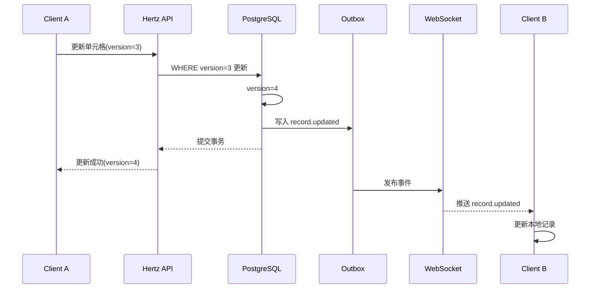

### 8.4 乐观锁 SQL

```sql
UPDATE base_record
SET
    data = data || :patch::jsonb,
    version = version + 1,
    updated_at = NOW(),
    updated_by = :operator_id
WHERE
    id = :record_id
    AND table_id = :table_id
    AND tenant_id = :tenant_id
    AND version = :expected_version
    AND deleted_at IS NULL
RETURNING version, data;
```

如果没有更新到记录，说明版本已过期或记录不可访问，服务端需要返回冲突或资源不可见结果。

实际执行时还需要在同一事务中更新投影、公式依赖、审计日志和 Outbox 事件。

### 8.5 WebSocket 事件结构

```json
{
  "eventId": "event_uuid",
  "eventType": "record.updated",
  "tenantId": "tenant_uuid",
  "baseId": "base_uuid",
  "tableId": "table_uuid",
  "recordId": "record_uuid",
  "version": 4,
  "operatorId": "user_uuid",
  "payload": {
    "fieldChanges": {
      "field_uuid_001": {
        "oldValue": "张三",
        "newValue": "李四"
      }
    }
  },
  "timestamp": "2026-11-26T08:30:00Z"
}
```

### 8.6 可靠性要求

- 事件发布采用 Transactional Outbox。
- 事件 ID 全局唯一。
- 消费者按 `eventId` 幂等处理。
- 事件必须携带记录版本。
- 客户端发现版本跳跃时，应重新请求记录或视图数据。
- WebSocket 断线后支持重连。
- 服务端根据用户权限过滤订阅与事件内容。
- 批量粘贴作为一个业务事务处理，并明确成功记录和失败记录。
- 不允许通过 WebSocket 事件绕过 HTTP API 的权限校验。

---

## 9. 权限体系

### 9.1 权限模型

采用 RBAC + DataScope + 字段权限的组合。

| 级别 | 权限范围 | 示例 |
|---|---|---|
| Workspace | 空间级 | 成员管理 |
| Base | 应用级 | 管理、编辑、查看 |
| Table | 表级 | 表结构管理、记录编辑 |
| Field | 字段级 | 查看、编辑、隐藏 |
| Record | 记录级 | 只能查看自己负责的数据 |

### 9.2 权限判断链

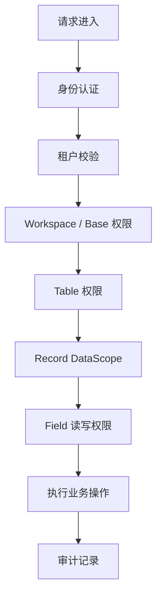

### 9.3 关键要求

- 服务端每次读取和写入都要进行权限校验。
- 字段隐藏不等于字段安全，敏感字段必须在 API 返回前过滤。
- 记录级权限应在 Query Engine 生成 SQL 时注入，而不是查询后在内存中删除记录。
- 批量操作逐条验证权限，不能只验证批次中的第一条记录。
- WebSocket 订阅和推送必须经过同一套权限策略。
- 权限变更后，清理或失效对应缓存与连接订阅。

---

## 10. API 接口设计

### 10.1 API 规范

统一前缀：

```text
/api/v1
```

统一响应：

```json
{
  "code": 0,
  "message": "success",
  "data": {},
  "requestId": "request_uuid"
}
```

统一错误码建议：

| 错误码 | 含义 |
|---|---|
| 0 | 成功 |
| 40001 | 参数校验失败 |
| 40101 | 未认证 |
| 40301 | 无权限 |
| 40401 | 资源不存在或不可见 |
| 40901 | 版本冲突 |
| 40902 | Schema 版本冲突 |
| 42201 | 字段值校验失败 |
| 42202 | 字段类型不兼容 |
| 42203 | 公式解析失败 |
| 42204 | 公式循环依赖 |
| 42901 | 请求过于频繁 |
| 50001 | 内部错误 |

错误响应应包含稳定的错误码、可读信息和 `requestId`，但不能泄露 SQL、堆栈或内部敏感信息。

### 10.2 Base API

| 方法 | 路径 | 说明 |
|---|---|---|
| POST | `/bases` | 创建 Base |
| GET | `/bases` | Base 列表 |
| GET | `/bases/{baseId}` | Base 详情 |
| PUT | `/bases/{baseId}` | 更新 Base |
| DELETE | `/bases/{baseId}` | 删除 Base |

### 10.3 Table API

| 方法 | 路径 | 说明 |
|---|---|---|
| POST | `/bases/{baseId}/tables` | 创建数据表 |
| GET | `/bases/{baseId}/tables` | 数据表列表 |
| GET | `/tables/{tableId}` | 表详情 |
| PATCH | `/tables/{tableId}` | 修改表信息 |
| DELETE | `/tables/{tableId}` | 删除数据表 |
| GET | `/tables/{tableId}/schema` | 获取表结构 |

### 10.4 Field API

| 方法 | 路径 | 说明 |
|---|---|---|
| POST | `/tables/{tableId}/fields` | 创建字段 |
| GET | `/tables/{tableId}/fields` | 字段列表 |
| PATCH | `/fields/{fieldId}` | 更新字段 |
| DELETE | `/fields/{fieldId}` | 删除字段 |
| POST | `/fields/{fieldId}/migrate` | 字段类型迁移 |
| GET | `/fields/types` | 获取支持的字段类型 |

字段类型 API 返回能力：

```json
{
  "types": [
    {
      "type": "number",
      "label": "数字",
      "capabilities": {
        "editable": true,
        "filterable": true,
        "sortable": true,
        "groupable": true
      },
      "configSchema": {
        "precision": {
          "type": "integer",
          "default": 2
        }
      }
    }
  ]
}
```

### 10.5 Record API

| 方法 | 路径 | 说明 |
|---|---|---|
| POST | `/tables/{tableId}/records` | 创建记录 |
| GET | `/tables/{tableId}/records` | 查询记录 |
| GET | `/records/{recordId}` | 记录详情 |
| PATCH | `/records/{recordId}` | 更新记录 |
| DELETE | `/records/{recordId}` | 删除记录 |
| POST | `/tables/{tableId}/records/batch` | 批量新增 |
| PATCH | `/tables/{tableId}/records/batch` | 批量更新 |
| POST | `/tables/{tableId}/records/batch-delete` | 批量删除 |

更新请求示例：

```json
{
  "expectedVersion": 3,
  "schemaVersion": 12,
  "fields": {
    "field_uuid_001": "李四"
  }
}
```

服务端必须校验字段归属、类型、权限、Schema 版本与 Record 版本。

### 10.6 View API

| 方法 | 路径 | 说明 |
|---|---|---|
| POST | `/tables/{tableId}/views` | 创建视图 |
| GET | `/tables/{tableId}/views` | 视图列表 |
| GET | `/views/{viewId}` | 视图详情 |
| PATCH | `/views/{viewId}` | 更新视图配置 |
| DELETE | `/views/{viewId}` | 删除视图 |
| POST | `/views/{viewId}/query` | 按视图查询数据 |

### 10.7 Formula API

| 方法 | 路径 | 说明 |
|---|---|---|
| POST | `/tables/{tableId}/formulas/validate` | 校验公式 |
| POST | `/tables/{tableId}/formulas/preview` | 预览公式 |
| GET | `/fields/{fieldId}/formula` | 获取公式定义 |
| PUT | `/fields/{fieldId}/formula` | 更新公式 |
| GET | `/fields/{fieldId}/formula/dependencies` | 获取依赖关系 |

### 10.8 WebSocket API

连接地址：

```text
/ws/v1/bases/{baseId}
```

订阅消息：

```json
{
  "action": "subscribe",
  "resources": [
    {
      "type": "table",
      "id": "table_uuid"
    }
  ]
}
```

取消订阅：

```json
{
  "action": "unsubscribe",
  "resources": [
    {
      "type": "table",
      "id": "table_uuid"
    }
  ]
}
```

服务端推送事件采用前述统一事件协议。

### 10.9 API 设计补充

必须实现以下横切能力：

- 幂等键：批量创建、导入和重试请求使用 `Idempotency-Key`。
- 版本控制：记录使用 `version`，Schema 使用 `schemaVersion`。
- 游标分页：大表默认 Cursor Pagination。
- 批量事务：明确全部成功或部分成功的语义。
- 请求追踪：所有请求携带 `requestId`。
- 限流：按租户、用户、API 类型限流。
- OpenAPI：自动生成接口文档和前端 TypeScript 类型。
- 文件上传：附件通过独立文件 API，不经过 Record JSONB 上传二进制内容。

---

## 11. 前端技术架构与目录结构

### 11.1 前端技术栈

| 技术 | 用途 |
|---|---|
| Vue 3 | UI 框架 |
| TypeScript | 类型系统 |
| Vite | 构建工具 |
| VXE Table | Grid 交互 |
| Pinia | 状态管理 |
| Vue Router | 路由 |
| TanStack Query for Vue | 服务端状态缓存，可选 |
| Zod | 前端配置与数据校验 |
| Vitest | 单元测试 |
| Playwright | E2E 测试 |

VXE Table 只作为 Grid Adapter 的底层实现，视图业务层不能直接散落 VXE Table 的专有配置。

### 11.2 前端目录结构

```text
web/
├── public/
├── src/
│   ├── app/
│   │   ├── router/
│   │   ├── providers/
│   │   └── bootstrap/
│   │
│   ├── components/
│   │   ├── common/
│   │   ├── dialog/
│   │   ├── selector/
│   │   └── upload/
│   │
│   ├── modules/
│   │   ├── base/
│   │   │   ├── api/
│   │   │   ├── components/
│   │   │   ├── composables/
│   │   │   ├── stores/
│   │   │   ├── types/
│   │   │   └── pages/
│   │   │
│   │   ├── base-engine/
│   │   │   ├── core/
│   │   │   │   ├── registry/
│   │   │   │   ├── events/
│   │   │   │   ├── schema/
│   │   │   │   └── errors/
│   │   │   │
│   │   │   ├── fields/
│   │   │   │   ├── registry/
│   │   │   │   ├── text/
│   │   │   │   ├── number/
│   │   │   │   ├── date/
│   │   │   │   ├── select/
│   │   │   │   ├── checkbox/
│   │   │   │   ├── user/
│   │   │   │   ├── attachment/
│   │   │   │   ├── relation/
│   │   │   │   └── formula/
│   │   │   │
│   │   │   ├── grid/
│   │   │   │   ├── adapter/
│   │   │   │   ├── editor/
│   │   │   │   ├── renderer/
│   │   │   │   ├── clipboard/
│   │   │   │   ├── selection/
│   │   │   │   └── virtual/
│   │   │   │
│   │   │   ├── views/
│   │   │   │   ├── registry/
│   │   │   │   ├── grid/
│   │   │   │   ├── kanban/
│   │   │   │   ├── calendar/
│   │   │   │   ├── gallery/
│   │   │   │   └── form/
│   │   │   │
│   │   │   ├── query/
│   │   │   ├── formula/
│   │   │   ├── relation/
│   │   │   ├── realtime/
│   │   │   ├── permission/
│   │   │   └── history/
│   │   │
│   │   └── document/
│   │       ├── editor/
│   │       ├── extensions/
│   │       └── collaboration/
│   │
│   ├── shared/
│   │   ├── api/
│   │   ├── hooks/
│   │   ├── types/
│   │   ├── utils/
│   │   └── constants/
│   │
│   ├── styles/
│   └── main.ts
│
├── tests/
├── package.json
└── vite.config.ts
```

### 11.3 前端关键设计

**Grid Adapter**

定义统一网格接口：

```ts
interface GridAdapter {
  setColumns(columns: GridColumn[]): void
  setRows(rows: GridRecord[]): void
  updateCell(recordId: string, fieldId: string, value: unknown): void
  getSelectedRecords(): string[]
  refresh(): Promise<void>
}
```

VXE Table 适配器实现上述接口。未来即使更换网格组件，也不需要修改 Field Engine 和 Record Engine。

**Field Editor / Renderer**

每种字段有独立编辑器和渲染器：

```text
NumberField
├── NumberEditor.vue
├── NumberRenderer.vue
├── NumberConfig.vue
└── number-field.ts
```

**实时更新**

- 当前用户的修改由 HTTP API 确认后更新本地状态。
- 其他用户的修改由 WebSocket 事件更新。
- 本地编辑期间保存 `expectedVersion`。
- 冲突时提示用户，并根据字段级差异决定重新加载或手动处理。
- 不允许简单用最新事件覆盖正在编辑的本地输入。

---

## 12. 后端技术架构与目录结构

### 12.1 后端技术栈

| 技术 | 用途 |
|---|---|
| Go | 后端语言 |
| Hertz | HTTP 框架 |
| Gorm | ORM |
| PostgreSQL | 业务数据库 |
| Redis | 缓存、连接协调 |
| MinIO | 附件对象存储 |
| WebSocket | 实时事件推送 |
| OpenTelemetry | 链路追踪 |
| Prometheus | 指标监控 |
| Zap / Zerolog | 结构化日志 |

### 12.2 后端目录结构

结合此前 GoForge / 芋道源码风格，建议：

```text
server/
├── cmd/
│   └── server/
│       └── main.go
│
├── internal/
│   ├── bootstrap/
│   ├── config/
│   ├── server/
│   │
│   ├── module/
│   │   ├── base/
│   │   │   ├── app/
│   │   │   │   ├── controller/
│   │   │   │   ├── service/
│   │   │   │   ├── repository/
│   │   │   │   ├── model/
│   │   │   │   └── dto/
│   │   │   │
│   │   │   ├── table/
│   │   │   ├── field/
│   │   │   ├── record/
│   │   │   ├── view/
│   │   │   ├── query/
│   │   │   ├── relation/
│   │   │   ├── formula/
│   │   │   ├── permission/
│   │   │   ├── realtime/
│   │   │   ├── audit/
│   │   │   ├── attachment/
│   │   │   └── import_export/
│   │   │
│   │   └── document/
│   │       ├── controller/
│   │       ├── service/
│   │       ├── repository/
│   │       └── model/
│   │
│   ├── platform/
│   │   ├── database/
│   │   ├── redis/
│   │   ├── storage/
│   │   ├── websocket/
│   │   ├── eventbus/
│   │   ├── auth/
│   │   ├── tenant/
│   │   ├── middleware/
│   │   ├── logger/
│   │   └── tracing/
│   │
│   └── shared/
│       ├── errors/
│       ├── response/
│       ├── pagination/
│       ├── validator/
│       ├── constants/
│       └── utils/
│
├── migrations/
├── scripts/
├── tests/
├── docs/
├── go.mod
└── Makefile
```

### 12.3 后端分层约束

| 层 | 职责 | 禁止事项 |
|---|---|---|
| Controller | HTTP 参数解析、响应 | 不直接写 Gorm 查询 |
| Service | 用例编排、事务控制 | 不承担 HTTP 细节 |
| Domain | 业务规则、类型校验 | 不依赖 Hertz |
| Repository | 数据持久化 | 不处理业务权限策略 |
| Platform | 数据库、缓存、事件、存储 | 不耦合具体业务模块 |
| DTO | 请求响应结构 | 不直接暴露 ORM Model |

### 12.4 事务设计

Record 更新应统一通过 `RecordService`：

```text
RecordService.Update
    ├── LoadTableSchema
    ├── CheckPermission
    ├── ValidateFieldValues
    ├── CheckRecordVersion
    ├── UpdateRecordJSONB
    ├── UpdateRecordProjection
    ├── UpdateRelation
    ├── UpdateFormulaDependency
    ├── WriteAuditLog
    ├── WriteOutboxEvent
    └── Commit
```

事务内只做必须强一致的写操作。耗时公式计算、通知推送、外部 Webhook 等放到事务提交后的异步任务。

---

## 13. Tiptap 文档引擎与 Base Engine 的融合

两个引擎应当共享平台能力，但保持领域隔离。

### 13.1 产品级模块关系

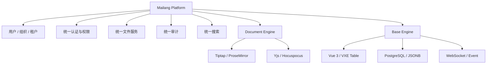

### 13.2 两个引擎的边界

| 能力 | Document Engine | Base Engine |
|---|---|---|
| 核心数据 | 文档内容 | 结构化记录 |
| 前端编辑器 | Tiptap | VXE Table |
| 实时协同 | Yjs + Hocuspocus | WebSocket + Event |
| 存储 | Yjs Binary / 文档结构化视图 | PostgreSQL JSONB |
| 历史版本 | 文档快照与更新记录 | Record Revision |
| 评论锚点 | Yjs Relative Position | Record / Field / Cell 锚点 |
| 权限 | 文档权限 | Base / Table / Field / Record 权限 |

### 13.3 共享基础服务

两个引擎可以共用：

- 用户、组织、租户。
- 统一身份认证。
- 文件与附件服务。
- 操作审计。
- 消息通知。
- 搜索基础设施。
- API 网关。
- 监控与链路追踪。

但不应共用 Record Model、Document Model、协同数据协议。

### 13.4 文档和多维表格之间的集成

后续可以支持：

- 文档中嵌入 Base 视图。
- Base 记录关联文档。
- 文档引用某条记录。
- Base 自动化触发文档生成。
- 文档中展示 Base 查询结果。

这些集成通过 API 和资源引用实现，不应把文档正文直接复制到 Base 记录中。

---

## 14. 开发里程碑与实施计划

建议按 5 个阶段推进，先完成可用的 Grid Engine，再逐步补齐领域能力。整体周期建议为 **12～16 周**，具体取决于团队人数、已有平台基础和测试覆盖要求。

### 14.1 里程碑总览

<list connector="solid" marker="number" gap={3}>
  <list-item>
    **M0：工程基础与领域建模（第 1～2 周）**

    交付：
    - 前后端工程初始化。
    - PostgreSQL 数据库迁移体系。
    - Base、Table、Field、Record 领域模型。
    - 统一 API 响应、错误码、租户上下文。
    - Gorm Repository 和事务管理。
    - OpenAPI 规范与基础 CI。

    验收：可以创建 Base、Table、Field，并完成数据库迁移和自动化测试。
  </list-item>
  <list-item>
    **M1：核心 Grid Engine（第 3～5 周）**

    交付：
    - VXE Table Adapter。
    - Field Registry 第一批字段类型。
    - Record CRUD。
    - 单元格编辑、自动保存。
    - 批量新增、更新、删除。
    - 筛选、排序、分页。
    - JSONB 记录存储和查询投影。
    - 版本控制与操作审计。

    验收：可以创建一张多维表格，动态增加字段、编辑记录、筛选排序，刷新后数据保持一致。
  </list-item>
  <list-item>
    **M2：View Engine 与查询引擎（第 6～8 周）**

    交付：
    - View Registry。
    - Grid View 配置。
    - 视图共享与个人偏好。
    - Filter AST。
    - Sort、Group、Pagination。
    - 字段显隐、列宽、冻结列。
    - 查询执行计划与索引优化。

    验收：同一张 Table 创建多个 Grid View，各视图使用同一份 Record 数据，视图配置互不覆盖。
  </list-item>
  <list-item>
    **M3：公式、关联与实时事件（第 9～12 周）**

    交付：
    - Formula Lexer、Parser、AST。
    - 基础函数注册表。
    - 公式依赖图与循环依赖检测。
    - Relation Field。
    - WebSocket Gateway。
    - Transactional Outbox。
    - 乐观锁冲突处理。
    - 权限基础框架。

    验收：两张表可以建立关联，公式能随依赖数据变化重新计算；多个用户同时编辑时能正确检测冲突并同步。
  </list-item>
  <list-item>
    **M4：企业级加固与 Engine 发布（第 13～16 周）**

    交付：
    - 租户隔离与字段、记录权限。
    - 批量操作可靠性。
    - 字段迁移机制。
    - 导入导出基础能力。
    - 附件集成。
    - 压测、故障恢复、监控告警。
    - API 和扩展开发文档。
    - 可运行演示项目。

    验收：通过安全、性能、可靠性测试，形成可复用的 Base Engine。
  </list-item>
</list>

### 14.2 任务拆分建议

| 模块 | 主要交付 | 负责人建议 |
|---|---|---|
| 前端 Grid | VXE Adapter、编辑器、渲染器 | 前端 |
| 前端 Field | Field Registry、字段组件 | 前端 |
| 后端 Base | Base、Table、Field API | 后端 |
| 后端 Record | CRUD、JSONB、事务 | 后端 |
| Query | Filter AST、Sort、Pagination | 后端 |
| View | View Registry、Config | 前后端协作 |
| Formula | Parser、AST、Evaluator | 后端主导 |
| Relation | Link、Lookup 基础 | 后端 |
| Realtime | Outbox、WebSocket | 后端 |
| Permission | RBAC、DataScope、Field Policy | 后端 |
| QA | 单测、集成、E2E、压测 | 测试 |

---

## 15. 验收标准

验收不能只以“页面能展示数据”为标准，应覆盖功能、数据正确性、性能、并发、权限和可扩展性。

### 15.1 功能验收

| 编号 | 验收项 | 通过标准 |
|---|---|---|
| F-001 | Base 管理 | 可以创建、查询、修改、删除 Base |
| F-002 | Table 管理 | 一个 Base 可以管理多张 Table |
| F-003 | Field 管理 | 可以动态创建、修改、删除字段 |
| F-004 | Field Registry | 新增字段类型无需修改 Record Engine 核心逻辑 |
| F-005 | Record CRUD | 可以创建、读取、更新、删除记录 |
| F-006 | JSONB 存储 | 字段值持久化，字段重命名不影响数据 |
| F-007 | Grid | 支持单元格编辑、列宽、冻结列 |
| F-008 | 批量编辑 | 支持多行、多列粘贴和批量保存 |
| F-009 | Query | 支持组合筛选、排序、分页 |
| F-010 | View | 多个视图共享同一份记录数据 |
| F-011 | Formula | 支持首批函数和基础算术表达式 |
| F-012 | Relation | 支持跨表记录关联 |
| F-013 | Realtime | 多客户端能收到记录变更事件 |
| F-014 | Conflict | 过期版本更新返回明确冲突 |
| F-015 | Audit | 可以追踪记录修改人和修改前后数据 |
| F-016 | Permission | 租户、表、字段、记录权限生效 |

### 15.2 性能验收建议

以下是项目初始验收目标，不是对当前方案未经压测的性能承诺。应在约定硬件、数据规模和并发模型下进行验证。

| 指标 | 初始目标 |
|---|---|
| Grid 首屏 | 100 条记录、20 个字段，P95 ≤ 1.5 秒 |
| 单条记录更新 | P95 ≤ 200ms |
| 常规筛选查询 | P95 ≤ 500ms |
| 视图配置读取 | P95 ≤ 150ms |
| WebSocket 事件推送 | 服务端提交后 P95 ≤ 500ms |
| 批量编辑 | 100 条记录能够稳定提交 |
| 前端渲染 | 1000 条虚拟滚动记录可流畅操作 |
| 数据完整性 | 事务失败不产生部分持久化结果 |

压测环境应记录：

- CPU、内存、磁盘 IOPS。
- PostgreSQL 连接池大小。
- SQL 执行计划。
- Redis 命中率。
- WebSocket 在线连接数。
- 查询条件复杂度。
- 字段类型分布。
- 单表记录数与字段数。

### 15.3 并发验收

必须验证以下场景：

1. 两个用户同时修改同一记录的不同字段。
2. 两个用户同时修改同一个字段。
3. 一个用户编辑记录，另一个用户删除记录。
4. 一个用户修改字段定义，另一个用户使用旧 Schema 编辑。
5. 批量粘贴过程中出现版本冲突。
6. WebSocket 断线后重新连接。
7. 事件重复投递。
8. 事件乱序到达。
9. 公式计算完成事件晚于原始记录更新事件到达。

期望结果：

- 不丢失已确认写入的数据。
- 版本冲突有明确响应。
- 重复事件不会造成重复写入。
- 客户端发现版本跳跃后能够重新拉取数据。
- 权限变更后不再向无权用户推送敏感数据。

### 15.4 安全验收

- 租户之间不能读取或修改彼此的数据。
- 不允许通过猜测 Record ID 绕过权限。
- 不允许读取无权查看的字段。
- 不能通过 Formula 执行任意代码。
- 不能通过 Filter 参数注入 SQL。
- 上传文件必须进行权限验证和文件类型限制。
- WebSocket 连接必须鉴权。
- 事件推送不能泄露用户无权访问的数据。
- 操作日志不能被普通业务用户篡改。
- 敏感信息不得写入普通日志。

### 15.5 可扩展性验收

以下扩展场景应通过插件或新增模块实现，而不是重写核心代码：

- 新增一个字段类型。
- 新增一个视图类型。
- 新增一个公式函数。
- 新增一个查询操作符。
- 新增一个关系字段类型。
- 新增一个事件订阅消费者。
- 替换 VXE Table Adapter 的实现。

---

## 16. 数据一致性、可靠性与性能专项设计

### 16.1 数据一致性

建议明确三个一致性层级：

| 数据 | 一致性策略 |
|---|---|
| Record 主数据 | PostgreSQL 事务强一致 |
| Record 查询投影 | 与主数据同事务更新 |
| Formula 计算结果 | 同步计算保证强一致；异步计算必须标记状态 |
| Relation | PostgreSQL 事务强一致 |
| View Config | 版本控制与乐观锁 |
| WebSocket 事件 | Outbox 保证最终发布，客户端按版本恢复 |
| 缓存 | 允许短暂延迟，但必须有失效机制 |

### 16.2 批量编辑事务

批量粘贴可能包含几十至几百个单元格更新。

建议支持两种模式：

- `atomic`：整批成功或整批失败。
- `partial`：允许部分成功，返回逐行逐字段错误。

初期默认使用 `atomic`，避免用户误以为整批数据都保存成功。

对于超大导入任务，使用异步导入任务，不应在单个 HTTP 请求内处理几十万条记录。

### 16.3 PostgreSQL 优化

需要关注：

- JSONB GIN 索引。
- 类型化查询投影索引。
- 复合索引字段顺序。
- 查询计划与慢 SQL。
- 大表分页策略。
- 连接池和事务时长。
- 批量写入的锁竞争。
- JSONB 更新造成的行版本膨胀。
- 高频记录修改产生的 VACUUM 压力。

**不建议一开始为每个字段创建独立 PostgreSQL 索引。** 可以基于字段配置增加 `index_enabled`，由后台任务执行索引创建和维护，并记录索引成本。

### 16.4 大数据量策略

初期先使用单 PostgreSQL 集群，设计上预留：

- 按租户或 Base 分区的可能性。
- 大表按 `table_id` 进行数据访问隔离。
- 历史操作日志归档。
- 事件 Outbox 清理。
- 查询投影重建。
- 大批量任务异步执行。
- 只对实际高频字段建立索引。

在没有真实压测数据之前，不建议提前引入分库分表、复杂读写分离或多个数据库。

### 16.5 监控指标

| 指标 | 监控内容 |
|---|---|
| API | 请求量、错误率、P95/P99 |
| Query Engine | SQL 耗时、扫描行数、超时 |
| Record Engine | 写入量、冲突率、批量失败率 |
| Formula Engine | 计算耗时、失败数、依赖图规模 |
| Realtime | 在线连接数、推送延迟、重连次数 |
| PostgreSQL | 连接数、锁等待、慢 SQL、膨胀 |
| Redis | 命中率、内存、连接数 |
| Outbox | 待发布数量、失败数量、最老事件年龄 |

---

## 17. 测试体系

### 17.1 测试分层

| 层级 | 测试范围 | 工具建议 |
|---|---|---|
| 单元测试 | Field、Formula、Query AST | Go testing、Vitest |
| Repository 测试 | Gorm、PostgreSQL 查询 | Testcontainers |
| Service 集成测试 | 事务、权限、版本冲突 | Go testing |
| API 测试 | Hertz 接口 | httptest |
| 前端组件测试 | 字段编辑器、Grid Adapter | Vitest |
| E2E | 完整建表、编辑、筛选 | Playwright |
| 性能测试 | 查询、批量写入、实时推送 | k6 |
| 安全测试 | 租户隔离、权限绕过、注入 | 自动化测试与人工审查 |

### 17.2 关键测试用例

**Field Engine**

- 正确字段类型注册。
- 重复字段类型注册。
- 非法字段配置。
- 非法字段值。
- 字段迁移失败回滚。
- 未知字段类型兼容处理。

**Query Engine**

- AND / OR 嵌套条件。
- 文本、数字、日期筛选。
- 多字段排序。
- 空值排序。
- 分组与分页组合。
- 无权限字段查询。
- 非法字段 ID 和操作符。
- 大量过滤条件限制。

**Formula Engine**

- 运算符优先级。
- 嵌套函数。
- 类型错误。
- 空值传播。
- 除零。
- 循环依赖。
- 大规模依赖更新。
- 执行时间限制。
- 恶意表达式拒绝。

**Realtime Engine**

- 事件重复。
- 事件乱序。
- 断线重连。
- 版本跳跃。
- 权限撤销。
- Outbox 重试。
- 消费者崩溃恢复。

---

## 18. 部署架构

### 18.1 初期部署

建议使用模块化单体部署，WebSocket 可以作为同一 Go 服务中的独立模块，也可以独立部署进程。

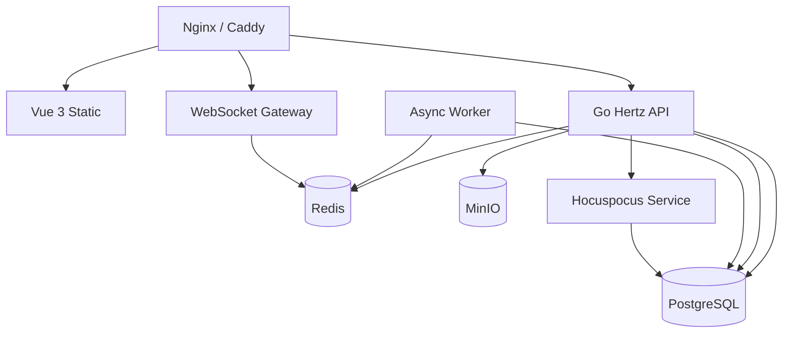

### 18.2 环境划分

| 环境 | 用途 |
|---|---|
| Local | 开发环境 |
| Dev | 联调环境 |
| Test | 自动化测试 |
| Staging | 预发布验收 |
| Production | 生产环境 |

生产环境必须具备：

- PostgreSQL 自动备份。
- Redis 持久化或可恢复策略。
- MinIO 对象存储备份。
- 数据库迁移版本管理。
- 应用健康检查。
- 日志集中采集。
- 指标监控。
- 故障告警。
- 版本回滚策略。

### 18.3 服务拆分策略

初期不要拆成十几个微服务。

建议先部署：

1. `mailang-api`：Hertz API。
2. `mailang-worker`：公式、导入导出、异步任务。
3. `mailang-web`：Vue 3。
4. `mailang-hocuspocus`：文档协同服务。
5. PostgreSQL、Redis、MinIO。

WebSocket 初期可以与 `mailang-api` 同进程，也可以单独部署 `mailang-realtime`。当连接规模和发布节奏要求明确后再拆分。

---

## 19. 项目配置与工程规范

### 19.1 环境配置

后端建议按环境分层：

```text
configs/
├── config.yaml
├── config.dev.yaml
├── config.test.yaml
├── config.staging.yaml
└── config.prod.yaml
```

核心配置项：

```yaml
app:
  name: mailang
  env: dev

server:
  http:
    port: 8080
  websocket:
    enabled: true

database:
  driver: postgres
  dsn: ${DATABASE_DSN}
  max_open_conns: 50
  max_idle_conns: 10

redis:
  addr: ${REDIS_ADDR}
  password: ${REDIS_PASSWORD}

storage:
  endpoint: ${MINIO_ENDPOINT}
  bucket: mailang

realtime:
  heartbeat_interval: 30s
  event_batch_size: 100

formula:
  max_ast_nodes: 1000
  max_depth: 64
  max_execution_steps: 10000
  timeout: 2s
```

配置中的连接地址、密码、密钥应从环境变量或密钥管理系统注入，不要提交生产凭据到代码仓库。

### 19.2 代码规范

- Go 使用标准格式化、静态检查和错误包装。
- Vue 统一使用 TypeScript。
- API DTO 与数据库 Model 分离。
- 数据库变更必须通过 Migration。
- 业务模块不允许直接跨模块操作其他模块的 Repository。
- 核心领域能力必须有单元测试。
- 公式和查询表达式必须有安全边界测试。
- 所有外部 API 必须有 OpenAPI 定义。
- 所有重要操作必须生成审计日志。

### 19.3 版本兼容

建议管理三种版本：

| 版本 | 作用 |
|---|---|
| `schema_version` | Table 结构版本 |
| `field.version` | 字段配置版本 |
| `record.version` | 记录并发版本 |

前端加载数据时应获取当前 `schemaVersion`。当结构发生变化时，旧客户端不能继续使用过期字段配置写入数据。

---

## 20. 最终技术决策清单

以下决策作为项目后续开发的基线，除非经过架构评审，不建议在开发过程中随意变更。

| 编号 | 技术决策 | 状态 |
|---|---|---|
| ADR-001 | 前端采用 Vue 3 + TypeScript | <badge color="success">确定</badge> |
| ADR-002 | Grid 采用 VXE Table Adapter | <badge color="success">确定</badge> |
| ADR-003 | 后端采用 Go Hertz + Gorm | <badge color="success">确定</badge> |
| ADR-004 | 数据库采用 PostgreSQL | <badge color="success">确定</badge> |
| ADR-005 | 记录主数据使用 JSONB | <badge color="success">确定</badge> |
| ADR-006 | 高频查询使用类型化投影表 | <badge color="success">确定</badge> |
| ADR-007 | 字段采用 Field Registry | <badge color="success">确定</badge> |
| ADR-008 | 视图采用 View Engine | <badge color="success">确定</badge> |
| ADR-009 | 公式采用 AST + Dependency Graph | <badge color="success">确定</badge> |
| ADR-010 | 多维表格实时同步采用 Event + WebSocket | <badge color="success">确定</badge> |
| ADR-011 | 文档协同继续使用 Tiptap + Yjs | <badge color="success">确定</badge> |
| ADR-012 | 初期采用模块化单体 | <badge color="success">确定</badge> |
| ADR-013 | 采用 RBAC + DataScope + Field Policy | <badge color="success">确定</badge> |
| ADR-014 | 采用 Transactional Outbox | <badge color="success">确定</badge> |
| ADR-015 | Engine 优先，不一次性实现全部 Base 产品能力 | <badge color="success">确定</badge> |

---

## 21. 需要重点规避的架构风险

| 风险 | 可能后果 | 解决措施 |
|---|---|---|
| 直接把 VXE Table 当作业务引擎 | UI 与业务逻辑耦合 | Grid Adapter 隔离 |
| 记录全部使用 JSONB 且不做查询投影 | 动态筛选、排序性能不可控 | 类型化投影与索引 |
| 使用纯 EAV 存储所有字段值 | 多字段查询复杂、SQL 膨胀 | JSONB 主存储 + 投影 |
| 字段类型直接修改 | 老数据无法解析 | 字段迁移机制 |
| 公式使用 eval | 任意代码执行风险 | AST 与函数白名单 |
| 事件先广播后写数据库 | 客户端收到不存在的数据 | Outbox |
| 公式只在前端计算 | 排序、筛选、API 结果不一致 | 服务端权威计算 |
| 记录更新不使用版本控制 | 并发覆盖 | 乐观锁 |
| WebSocket 不做权限检查 | 数据泄露 | 订阅和推送权限校验 |
| 过早微服务化 | 开发和部署复杂度增加 | 模块化单体 |
| 共享视图与个人配置混用 | 用户之间相互覆盖 | 分离 View Config 和 Member Preference |

---

## 22. 最终建议：正式建设顺序

我建议将整个 Mailang 平台的能力划分为三个相互独立、共享基础设施的引擎：

<box border radius="lg" gap={3} padding={3}>
  <box gap={1}>
    <row align="center" justify="between">
      **Document Engine**
      <badge color="success">已有技术路线</badge>
    </row>
    <AsyncImage query="modern collaborative rich text document editor interface with blocks comments toolbar clean desktop UI" aspectRatio="16:5" width="100%"/>
    - Vue 3 + Tiptap 3 + ProseMirror
    - Yjs + Hocuspocus
    - 文档内容、评论、版本、实时协同
  </box>
  <divider color="subtle"/>
  <box gap={1}>
    <row align="center" justify="between">
      **Base Engine**
      <badge color="success">本次正式确定</badge>
    </row>
    <AsyncImage query="modern no code database spreadsheet grid app interface with colored select fields filter views and records" aspectRatio="16:5" width="100%"/>
    - Vue 3 + VXE Table
    - Go Hertz + Gorm
    - PostgreSQL JSONB
    - Field / Record / View / Query / Formula / Relation
    - WebSocket + Event
  </box>
  <divider color="subtle"/>
  <box gap={1}>
    <row align="center" justify="between">
      **Spreadsheet Engine**
      <badge color="secondary">后续规划</badge>
    </row>
    <AsyncImage query="modern spreadsheet application interface formula bar Excel style cells charts desktop" aspectRatio="16:5" width="100%"/>
    - Univer
    - 电子表格、公式、单元格计算
    - Excel 导入导出
  </box>
</box>

这三个引擎不要混成一个编辑器：文档解决内容协作，多维表格解决结构化数据管理，电子表格解决单元格计算与传统表格办公。

**推荐实施顺序：**

1. 先完成 Base、Table、Field、Record 和 VXE Grid，形成真正可使用的多维表格基础产品。
2. 再完成 View、Query、Formula、Relation，形成可复用的 Base Engine。
3. 最后完成实时事件、权限、审计、导入导出和企业级加固。
4. 通过统一用户、组织、权限、附件、审计和 API 层，将 Base Engine 与 Tiptap 文档引擎整合到 Mailang 平台。

**最终架构定位：Mailang = Enterprise Platform + Document Engine + Base Engine + Spreadsheet Engine。**

这条路线能够延续已经确定的 Vue 3、Go Hertz、Gorm 和 Tiptap 技术体系，同时避免将文档协同和结构化数据协同错误地合并为同一种技术实现。

下一步最值得做的是将本设计转成可直接进入开发的工程基线：PostgreSQL 完整 DDL、Go 模块骨架、Field Registry 首批实现、VXE Grid Demo，以及 OpenAPI 契约。

---

If you want, I can:

- 继续描述 Relation 关联字段设计
- 详细说明公式引擎依赖和计算流程
- 介绍多维表格实时协同机制设计